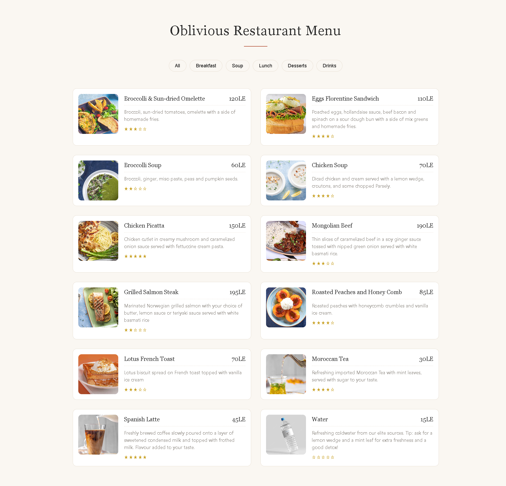
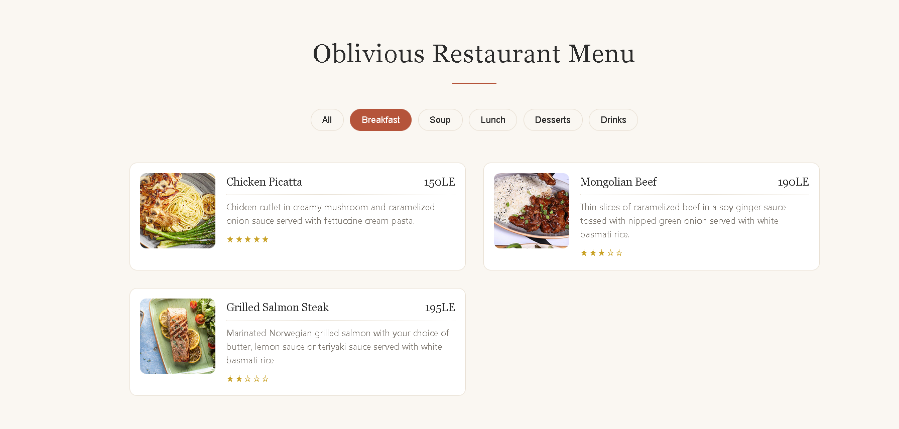

# Oblivious Restaurant Menu

A digital restaurant menu with dishes grouped by category. Visitors can filter the menu by category, and click any dish to see its full details in a popup.

## Screenshots

### Full menu


### Filtering by category



## Features

- Menu data stored in a JavaScript array, so adding a dish takes one object
- Filter buttons generated automatically from the menu categories
- Responsive two-column grid on desktop, one column on phones
- Click any dish to open a popup with its description, price, and rating
- Clean, simple design with a warm cream and terracotta palette

## How to Run

1. Clone the repository:
   ```bash
   git clone https://github.com/abdallaahemd/Oblivious-Restaurant-Menu.git
   ```
2. Open the project folder.
3. Open `index.html` in your browser.

## Project Structure

```
Oblivious-Restaurant-Menu/
├── index.html      # Page layout
├── styles.css      # Styles
├── app.js          # Menu data, filters, and popup logic
├── menuItems/      # Dish photos
└── screenshots/    # Screenshots used in this README
```

## What I Learned

- Using `map()` and `join()` to build HTML from an array
- Using `reduce()` to collect unique categories
- Filtering data with `filter()`
- Event delegation with `closest()` for elements added after the page loads
- Building a reusable popup with `createElement` and `innerHTML`

## Built With

- HTML
- CSS
- JavaScript
- Font Awesome

## Author

**Abdallah Ahmed**: Programming instructor and developer
- LinkedIn: https://www.linkedin.com/in/abdalla-konsowa-386414203
- itch.io: https://abdallak.itch.io/
